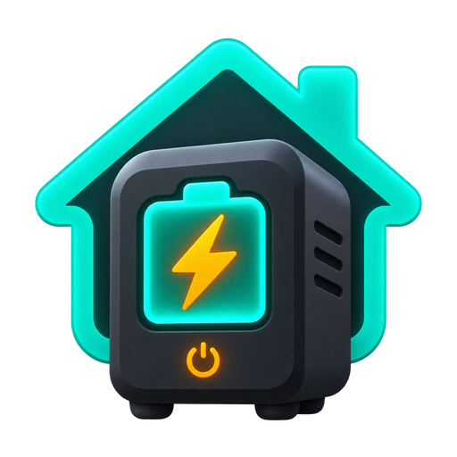

<p align="center"></p>

# Argon UPS

A community Home Assistant custom integration for the **Argon PWR UPS 27W
5000mAh**, using its direct USB serial connection. Configuration is entirely in
the Home Assistant UI. No MQTT, add-on, Argon daemon or Raspberry Pi OS packages
are required.

**Experimental: protocol verified against official source code, with an initial
live status reading confirmed by the user. Power transitions, physical shutdown
and power recovery remain untested.**
USB enumeration alone does not validate the protocol or serial access from Core.
This project is not affiliated with or endorsed by Argon40.

## Entities and behavior

| Entity | Meaning |
| --- | --- |
| Battery | UPS-reported battery percentage, 0–100%, measurement sensor |
| On battery | `on`: battery power; `off`: external power |

Both entities belong to one device and share one poll every 10 seconds. Each
poll requests status first, then one optional diagnostic. Replies are checked
for framing, payload length,
checksum and battery range. Fragmented replies and leading noise are supported.
Out-of-range percentages are rejected instead of silently clamped.

A missing, malformed or corrupt response times out after about 3 seconds
(plus bounded serial writes). Both entities become **unavailable** after a failed
poll; the previous values must not be treated as live readings. The serial
connection closes on failure and the next poll reconnects. Startup failures use
Home Assistant's automatic setup retry. Unloading releases the port.

### Additional read-only diagnostics

| Diagnostic sensor | Interpretation |
| --- | --- |
| UPS version | Raw version byte returned by command `0x04`; this is not the integration version |
| Charge current | Unsigned 16-bit big-endian value from command `0x02`, displayed in mA with an assumed scale |

Both are diagnostic entities on the same UPS device. Since 0.5.0, RTC and next
scheduled start are no longer queried or exposed. Their old registry entries
are removed on successful integration setup, including user-renamed entities.
The integration never sets the RTC, programs a start time or resets the battery
meter. Battery, power-source and current entity IDs are preserved; the current
entity keeps its historical `_charge_current_raw` ID while its displayed name
becomes **Charge current**.

One diagnostic is queried after each successful battery/power poll, rotating
through the two diagnostic commands. Each diagnostic normally refreshes roughly
every 20 seconds; response delays can lengthen that interval. There is only one
serial client. Each optional transaction has a bounded timeout, and its failure
makes only that diagnostic unavailable. A failure of the main status query
makes all entities unavailable and clears cached diagnostics. Recovery of each
diagnostic waits for its own next successful query. Unsupported optional
queries do not force reopening an otherwise healthy serial connection.

**The 0.5.0 changes are published without running tests at the user's request.**
Charge-current changes have been observed on the user's device, but the unit
and measurement point have not been independently validated. The shutdown
blueprint continues to use only battery percentage and on-battery status.

Version 0.4.1 exposes `read_command`, `query_status`, `last_query_time` and,
on failure, `last_error` and up to 512 received bytes in `raw_response`.
Checksum-valid payloads rejected by the decoder are retained in `raw_payload`.
Warnings also retain failure evidence when Home Assistant omits attributes from
an unavailable entity. A query status of `no_response` means no bytes arrived; `no_matching_valid_response`
can mean an echo, another command, incomplete framing or a bad checksum;
`invalid_payload` identifies a matching checksum-valid response whose decoded
contents were rejected.

Failures are logged at warning level once per reason/message transition, with
raw protocol bytes, and recovery at info level. No debug logging or UPS
configuration changes are needed to investigate communication failures.

The user observed raw charge current changing from 0 on battery to 2250 after
connecting external power. This supports its relationship to charging but does
not establish the scale or measurement point. Neither the official serial
reader nor the inspected HID descriptor confirmed milliamp units for this
serial value. Since 0.5.0, **milliamps are assumed at the user's request**:
2250 is displayed as 2250 mA (2.25 A). The sensor has current device class and
measurement state class, with `unit_status: assumed`. This is not a calibrated
measurement or proof of the current measurement point.

See [USB protocol research](docs/PROTOCOL-RESEARCH.md) for captured date frames,
the observed charging sequence, read-only HID results and the remaining limits
of the milliamp hypothesis. An empty next-start frame identical to the query
does not establish that the alarm is disabled.

## Requirements

- Home Assistant **2026.3 or later**, including support for local integration icons.
- A UPS exposing the protocol described below through a serial device that
  **Home Assistant Core can access**, with read/write permissions.
- Exclusive use of the serial port. Stop any other UPS reader first.

The reported host is a Raspberry Pi 5 with HAOS. Its UPS enumerates as
`Argon Argon_USB`, VID:PID `1d6b:0104`, with `/dev/ttyACM0` and `/dev/hidraw0`.
The serial interface is used; the HID interface is not used. These identifiers
are context from one installation, not a promise that every Argon model works.

On that installation, `dtoverlay=dwc2,dr_mode=host` was required for USB detection.
This integration does not change boot settings, device permissions or HAOS.
An SSH add-on seeing a port does not guarantee that Home Assistant Core sees it.

### Raspberry Pi 5: missing USB detection

The [official Argon USB OTG guide](https://argon40help.zendesk.com/hc/en-gb/articles/17758247401615-Argon-PWR-27W-UPS-for-Raspberry-Pi-5-Setup-USB-OTG-Detection-and-Troubleshooting)
documents the host-mode overlay for this hardware. This is a **manual host
prerequisite**, not a setting the integration can apply. On HAOS, Core runs in
a separate container and does not have supported access to the host's boot
partition. A missing port can also mean a cable, permission or hardware problem;
it does not prove that the overlay is missing.

If USB is already detected, do not repeat this change. Otherwise, from the
**HAOS host shell** (not an ordinary SSH add-on shell), inspect
`/mnt/boot/config.txt` and check whether an active `[all]` section already
contains this exact line:

```ini
dtoverlay=dwc2,dr_mode=host
```

If it is absent, make a backup of `config.txt` with a new, unused filename, then
add the line once under `[all]`. Review existing `dwc2` overlays and conflicting
host/gadget settings before editing; do not blindly duplicate them. Restart the
host manually when ready, then confirm the serial device appears. A Core-only
restart does not apply boot overlays. See the
[HAOS host configuration documentation](https://contributors.home-assistant.io/os/operating-system/configuration/).

The setup form explains this prerequisite, but never edits boot files or
restarts the host. Automatically applying it would require a separately designed
privileged host component; that is outside this integration's scope.

## Installation with HACS

1. In HACS, open **Custom repositories** and add
   `https://github.com/rpmlourenco/ArgonUPS` as type **Integration**.
2. Download **Argon UPS**.
3. Restart Home Assistant yourself when ready to load the new integration.
4. Go to **Settings → Devices & services**. If the UPS appears under
   **Discovered**, select **Configure**. Otherwise select **Add integration →
   Argon UPS**.
5. Enter the persistent serial path visible to Core. See
   [Finding the UPS serial device path](#finding-the-ups-serial-device-path).
   The path detected on the original installation is:

   ```text
   /dev/serial/by-id/usb-Argon_Argon_USB_6B21220CD2C7348A-if00
   ```

The form sends one status query to verify communication before saving. For a
different device, use its own path. The generic form default is `/dev/ttyACM0`;
prefer `/dev/serial/by-id/` because numbered ports can change after reboot.
The flow resolves numbered ports to their persistent by-id alias when available,
and rejects entries already configured with that canonical path.

USB discovery matches VID:PID `1D6B:0104`, manufacturer `Argon`, and a product
description containing `Argon_USB` (case insensitive). Matching only VID:PID
would also claim unrelated Linux USB gadgets. Discovery offers the normal Home
Assistant setup card and prefilled port, but sends no serial command until you
confirm setup. Home Assistant loads the `usb` dependency, and Core must see the
device. Different firmware metadata may
require manual setup. Discovery has simulated tests, not physical validation.

Once installed, Argon UPS participates in Home Assistant's normal config-entry,
device, entity and availability systems. It is still a **custom integration**;
Home Assistant does not include or download it automatically before HACS/manual
installation. Inclusion in Home Assistant Core would require a separate upstream
contribution and review.

HACS compatibility means installation as a custom repository; this project has
not been submitted to the HACS default repository list.

## Finding the UPS serial device path

Find the path on the **system running Home Assistant**, not on your Windows PC.
The serial number belongs to your UPS: do not copy the example unchanged unless
it matches your own device.

### From the Home Assistant interface

1. Open **Settings → Connectivity → Serial**.
2. Find the USB device described as **Argon**, **Argon_USB**, or
   **Argon Argon_USB**. If necessary, select **Refresh**.
3. Open **Port information** and copy the **Device** field. Prefer a path
   beginning with `/dev/serial/by-id/`.
4. Paste the complete path into **Serial device path** in the Argon UPS setup
   form, then select **Submit**.

On older Home Assistant versions without the Serial panel, look under
**Settings → System → Hardware → All hardware** (possibly in the three-dot menu).
Find the Argon serial device and its `/dev/serial/by-id/` entry. If the UI only
shows a numbered port such as `/dev/ttyACM0`, use the shell method below to find
its persistent link. See the
[Home Assistant serial documentation](https://www.home-assistant.io/connectivity/serial/).

### From a shell on the Home Assistant host

If you already have access to a HAOS host shell, list the persistent serial
links with this read-only command:

```sh
ls -l /dev/serial/by-id/
```

Look for an entry containing `Argon_Argon_USB`. For example, a link may look like:

```text
usb-Argon_Argon_USB_6B21220CD2C7348A-if00 -> ../../ttyACM0
```

Prefix the link name with `/dev/serial/by-id/`. The value to paste is:

```text
/dev/serial/by-id/usb-Argon_Argon_USB_6B21220CD2C7348A-if00
```

Do not paste `-> ../../ttyACM0` or the other columns printed by `ls`. The
`by-id` path and `/dev/ttyACM0` refer to the same serial interface, but the
numbered port can change after a reboot or when other USB devices are connected.
Do not select `/dev/hidraw0`: this integration uses the serial interface.

An SSH/Terminal app may also expose `/dev/serial/by-id/`, but its view of devices
can differ from Core and the host. If the directory or Argon entry is missing,
check the host or the Home Assistant interface before concluding that the UPS
is absent. If neither detects it, check the USB connection and the
[Raspberry Pi 5 USB host-mode prerequisite](#raspberry-pi-5-missing-usb-detection).
Listing these links does not open the serial port or send commands to the UPS.

## Manual installation

When you choose to install, copy only `custom_components/argon_ups/` into your
Home Assistant configuration's `custom_components/argon_ups/` directory. Do not
copy the repository's outer `custom_components/__init__.py`. Restart Home
Assistant yourself, then follow the UI configuration steps above. There is no
YAML configuration. To change the device path, remove and re-add the entry;
removing an integration may affect entity customizations and automations.

## Protocol and provenance

The implementation was written independently after inspecting these official
files at commit `a23299ba70fd76ce92ac3887a773ba770007832b`:

- [argonupsrtcd.py](https://github.com/Argon40Tech/Argon40case/blob/a23299ba70fd76ce92ac3887a773ba770007832b/src/scripts/argonupsrtcd.py)
  defines `ups_check`, the serial baud rate, request framing, payload lengths,
  checksum and power-state interpretation.
- [argonpwrups.sh](https://github.com/Argon40Tech/Argon40case/blob/a23299ba70fd76ce92ac3887a773ba770007832b/src/argonpwrups.sh)
  installs OS-specific utilities and services. It is reference material only;
  **do not run it on HAOS**.

| Field | Value |
| --- | --- |
| Serial | 115200 baud, 8 data bits, no parity, 1 stop bit; no flow control |
| Status request | `FE 00 00 FE` |
| Response | `FE length 00 battery state [optional extra payload] checksum` |
| Length | Number of payload bytes; status needs at least 2 |
| Battery | Percentage byte, expected 0–100 |
| State | Zero means external power; any nonzero byte means battery |
| Checksum | Sum of all preceding frame bytes modulo 256 |

Example synthetic response: `FE 02 00 4B 01 4C` = 75%, on battery.
The official reader clamps battery values above 100; this implementation rejects
them to avoid publishing a misleading reading. The source's variable naming
(`charging`) is ambiguous, but its display logic maps zero to charging/charged
and nonzero to battery. This is not a measured charging-current sensor.

The decoder accepts longer status payloads and ignores validated unrelated
commands and request echoes. Invalid checksums do not update entities. Responses
are bounded by the one-byte length, and transactions have a deadline. Only the
read commands `0x00`, `0x02` and `0x04` are transmitted. No RTC
write, alarm write, calibration/reset, charge-current configuration,
acknowledgement, shutdown or power-control commands are sent.

## Limitations and troubleshooting

An optional [safe host shutdown blueprint](docs/SAFE-SHUTDOWN.md) is available
for HAOS/Supervised with Argon UPS 0.3.0 or newer. Proposed starting values are
30% battery, 30 seconds continuous confirmation, and a maximum telemetry age of
30 seconds. Shutdown is disabled until explicitly armed in its inputs; the
integration does not install or enable the automation for you.

- No runtime estimate, voltage, calibrated current, UPS power-control service, low-battery
  cutoff or RTC controls. Physical shutdown and power recovery remain untested.
- The 10-second polling interval plus response timeout means this is not an
  instantaneous mains-failure alarm. Do not rely on this experimental integration
  as the sole protection against data loss or power failure.
- Serial opening uses pyserial defaults for DTR/RTS. Effects on device firmware
  and recovery after USB reconnection require hardware verification.
- If setup cannot connect, check the persistent path, Core access/permissions,
  cable and whether another process owns the port. Network serial URLs are not
  supported. `cat` alone is insufficient: the UPS must first receive a query.
- If entities become unavailable, inspect **Settings → System → Logs** for
  `custom_components.argon_ups`. Automatic reconnect continues; a valid poll
  restores both entities. Removing or unplugging the device does not mean that
  the power-source sensor should report `off`.
- Firmware/protocol variants and other Argon UPS models are unverified.

## Development and validation

All analysis and tests run on a PC or GitHub-hosted Linux runner. No access to a
production Home Assistant instance is needed. Synthetic test frames are not
captures from hardware.

Fast unit tests on Windows or Linux (Python 3.13+ recommended):

```shell
python -m venv .venv
# Activate the environment using your shell's normal activation command.
python -m pip install pytest pytest-asyncio pyserial ruff
python -m pytest tests/unit -q
ruff check .
ruff format --check .
```

Full Home Assistant tests on Linux, Python 3.14:

```shell
python -m pip install -r requirements-test.txt
python -m pytest -q
```

The pinned framework tests against Home Assistant 2026.10.4. The minimum
supported version is not independently runtime-tested. CI also runs hassfest and
the HACS validator. Unit tests cover fragmentation at every split, byte-wise
reads, checksum failure, corruption recovery, echoes, payload lengths, battery
boundaries, serial errors/timeouts, cleanup and reconnect. Home Assistant tests
cover configuration, USB discovery, canonical-path duplicates, both entities, unavailable/recovered states,
initial setup retry and unload.

Before declaring hardware support validated, explicitly authorize installation,
verify actual reads on the UPS, switch between external power and battery, and
test unplug/replug and HA startup with the UPS absent. Never deliberately drain
a production host's UPS for this test.

## Artwork and license

The original community icon is in [assets/icon.png](assets/icon.png). Home
Assistant receives 256px and 512px versions in `custom_components/argon_ups/brand/`.
See [assets/README.md](assets/README.md) for its generation prompt and provenance.
It is a project icon, not Argon40's official logo.

Source code is MIT licensed. See [LICENSE](LICENSE).
